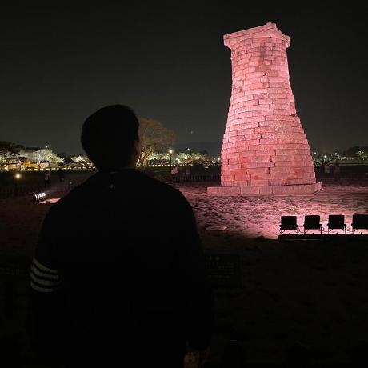

<link rel="stylesheet" href="{{ "/assets/css/academic.css" | relative_url }}">

INCOMING GRADUATE STUDENT · MARCH 2027

I’m **Junhwan (Chris) Jang**, preparing to begin graduate study at **Dongguk University** with [**Prof. Sojung Kim**](https://sites.google.com/site/sojungk8/) in the **Simulation-Based Optimization Laboratory**.

I am interested in **digital twins, simulation, and optimization**—understanding how complex systems behave and using models to inform better decisions. My background is in software engineering, where I have built and operated production backend services and independent products.

<a href="/cv/">Curriculum Vitae ↗</a><a href="/publications/">Publications ↗</a><a href="https://github.com/itsChrisJang">GitHub ↗</a>

<nav class="section-links" aria-label="On this page"><a href="#education">Education</a><a href="#research-interests">Research</a><a href="#publications">Publications</a><a href="#industry-experience">Experience</a></nav>

## Education



  
<strong>{{ item.school }}</strong>{{ item.period }}

  
{{ item.program }}

  
<a href="{{ item.url }}">{{ item.detail }}</a>{{ item.detail }}



## Research Interests

<article class="research-card">01 / MODEL<h3>Digital Twins</h3>
Representing real-world systems to explore behavior, test scenarios, and support operational decisions.
</article>
<article class="research-card">02 / SIMULATE<h3>Simulation</h3>
Agent-based modeling, discrete-event simulation, and system dynamics for complex interacting systems.
</article>
<article class="research-card">03 / OPTIMIZE<h3>Optimization</h3>
Simulation-based optimization and operations research for evaluating alternatives under uncertainty.
</article>

My intended research direction follows [Prof. Sojung Kim’s work](https://sites.google.com/site/sojungk8/) in digital twins, simulation, and optimization, with applications including supply chains, renewable energy, and smart farming systems.

## Publications





{{ publication_list }}



Research papers and preprints will be listed here as they become publicly available.



[View publication record →](/publications/)

## Research & Engineering Foundation

### Upcoming Graduate Research

**Simulation-Based Optimization Laboratory · Dongguk University**  
**Prof. Sojung Kim · Expected start: Mar 2027**

My planned graduate research will focus on **digital twins, simulation, and optimization**, aligned with Prof. Sojung Kim’s research. I aim to build on my software engineering background to implement models, evaluate system behavior, and develop decision-support tools.

| Research direction            | Planned focus                                                                |
| ----------------------------- | ---------------------------------------------------------------------------- |
| Digital twins                 | Modeling real-world systems and connecting models with operational data      |
| Simulation                    | Exploring agent-based models, discrete-event simulation, and system dynamics |
| Simulation-based optimization | Comparing scenarios and operational decisions under uncertainty              |

### Software Engineering Foundation

I bring practical experience in building event-driven services, preserving data consistency, and evaluating performance. These skills form a software engineering foundation for my transition into simulation and optimization research.

| Capability                        | Foundation & development focus                                                              | Research application                                                                        |
| --------------------------------- | ------------------------------------------------------------------------------------------- | ------------------------------------------------------------------------------------------- |
| System implementation             | Java, Spring Boot, Spring WebFlux; service design and operation                             | Implementing system interfaces and the software infrastructure around simulation models     |
| Event and state management        | Redis, Kafka, concurrency control, distributed locks                                        | Handling events and maintaining consistent system state in data-connected applications      |
| Performance evaluation            | API profiling, SQL execution plans, indexing, caching                                       | Measuring runtime behavior, locating bottlenecks, and comparing implementation alternatives |
| Experiment delivery               | Product planning, deployment, and operation                                                 | Turning models and decision-support ideas into usable software prototypes                   |
| Simulation model implementation   | Planned lab development: agent-based models, discrete-event simulation, and system dynamics | Translating system assumptions into executable models                                       |
| Digital-twin data integration     | Planned lab development: connecting operational data with model state                       | Keeping virtual system representations aligned with observed behavior                       |
| Optimization algorithms           | Planned lab development: simulation-based optimization and scenario search                  | Evaluating operational alternatives under constraints and uncertainty                       |
| Research experiments & validation | Planned lab development: calibration, sensitivity analysis, and reproducible experiments    | Testing model credibility and comparing outcomes systematically                             |

The planned development areas above are priorities for graduate study with Prof. Sojung Kim, beginning in March 2027.

## Industry Experience



<strong>{{ item.company }}</strong>{{ item.period }}

{{ item.summary }}



[Full experience & mentoring →](/experience/)

## Talks & Writing

**Data Consistency in High-Concurrency Events: A Redis Distributed Lock Case Study**  
SIPE 4th Conference · Aug 2, 2025

Production lessons on race conditions, fair access, atomic operations, and the tradeoffs of lock-based designs.

[Talks, engineering articles & resources →](/writing/)






<section class="site-traffic" aria-labelledby="traffic-heading" data-traffic-endpoint="{{ site.data.traffic.endpoint | escape }}">
<h2 id="traffic-heading">Site Visits</h2>

Today<strong data-count="today">—</strong>

Last 7 days<strong data-count="week">—</strong>

All time<strong data-count="total">—</strong>

Visits are counted in Korea Standard Time. Updates may be delayed by up to four hours.

<noscript>Visit statistics require JavaScript.</noscript>
</section>


