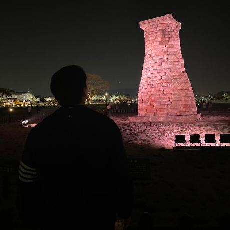

<link rel="alternate" hreflang="en" href="{{ site.url }}/">
<link rel="stylesheet" href="{{ "/assets/css/academic.css" | relative_url }}?v=20261108-2">

연구와 엔지니어링<nav class="language-switch" aria-label="언어 선택"><a href="/" lang="en" hreflang="en">EN</a><a href="/ko/" lang="ko" hreflang="ko" aria-current="page">한국어</a></nav>

대학원 입학 예정 · 2027년 3월

안녕하세요, **장준환 (Chris)**입니다. **2027년 3월 동국대학교 대학원 입학을 앞두고**, [**김소정 교수님**](https://sites.google.com/site/sojungk8/)의 **시뮬레이션 기반 최적화 연구실**에서 연구를 시작할 예정입니다.

**디지털 트윈, 시뮬레이션, 최적화**를 통해 복잡한 시스템을 이해하고 더 나은 의사결정을 돕는 데 관심이 있습니다. 백엔드 서비스와 제품을 개발·운영한 소프트웨어 엔지니어링 경험을 연구로 이어가고자 합니다.

<a href="/ko/cv/">이력서 ↗</a><a href="/ko/publications/">논문 ↗</a><a href="https://github.com/itsChrisJang">GitHub ↗</a>

<nav class="section-links" aria-label="페이지 목차"><a href="#education">학력</a><a href="#research-interests">연구 관심 분야</a><a href="#publications">논문</a><a href="#industry-experience">경력</a></nav>

<h2 id="education">학력</h2>



  
<strong>{{ item.school_ko }}</strong>{{ item.period | replace: "Mar 2027 (expected)", "2027.03 (예정)" | replace: "Entered Sep 2025", "2025.09 입학" | replace: "Mar 2023 – Feb 2024", "2023.03 – 2024.02" | replace: "Mar 2024 – Jan 2026", "2024.03 – 2026.01" | replace: "Feb 2023 – Mar 2024", "2023.02 – 2024.03" | replace: "Sep 2022 – Oct 2022", "2022.09 – 2022.10" | replace: "Nov 2020 – Jul 2022", "2020.11 – 2022.07" | replace: "Present", "현재" }}

  
{{ item.program_ko }}

  
<a href="{{ item.url }}">{{ item.detail_ko }}</a>{{ item.detail_ko }}



<h2 id="research-interests">연구 관심 분야</h2>

<article class="research-card">01 / 모델링<h3>디지털 트윈</h3>
현실 시스템을 모델로 표현하고, 동작과 시나리오를 분석해 운영 의사결정을 지원합니다.
</article>
<article class="research-card">02 / 시뮬레이션<h3>시뮬레이션</h3>
에이전트 기반 모델링, 이산사건 시뮬레이션, 시스템 다이내믹스로 복잡한 상호작용을 탐구합니다.
</article>
<article class="research-card">03 / 최적화<h3>최적화</h3>
시뮬레이션 기반 최적화와 운영연구로 불확실성 아래의 대안을 평가합니다.
</article>

[김소정 교수님의 연구](https://sites.google.com/site/sojungk8/)를 바탕으로 디지털 트윈, 시뮬레이션, 최적화를 공부할 계획입니다. 공급망, 재생에너지, 스마트팜 등의 응용 분야에도 관심이 있습니다.

<h2 id="publications">논문</h2>





{{ publication_list }}



논문과 프리프린트는 공개되는 대로 이곳에 정리할 예정입니다.



[논문 목록 보기 →](/ko/publications/)

## 연구 및 엔지니어링 기반

### 앞으로의 대학원 연구

**동국대학교 · 시뮬레이션 기반 최적화 연구실**  
**김소정 교수 · 2027년 3월 시작 예정**

김소정 교수님의 연구 방향에 맞춰 **디지털 트윈, 시뮬레이션, 최적화**를 중심으로 연구할 계획입니다. 소프트웨어 개발 경험을 바탕으로 모델을 구현하고 시스템 동작을 평가하며 의사결정 지원 도구를 개발하고자 합니다.

소프트웨어 엔지니어링 기반 실무 경험과 앞으로 키울 연구 역량

### 소프트웨어 엔지니어링 기반

이벤트 기반 서비스 개발, 데이터 정합성 유지, 성능 평가의 실무 경험을 시뮬레이션 및 최적화 연구의 기반으로 삼고자 합니다.

| 역량                    | 경험 및 학습 방향                                                     | 연구에서의 활용                                                 |
| ----------------------- | --------------------------------------------------------------------- | --------------------------------------------------------------- |
| 시스템 구현             | Java, Spring Boot, Spring WebFlux 기반 서비스 설계 및 운영            | 시뮬레이션 모델을 위한 인터페이스 및 소프트웨어 기반 구현       |
| 이벤트 및 상태 관리     | Redis, Kafka, 동시성 제어, 분산 락                                    | 데이터 연동 애플리케이션의 이벤트 처리와 상태 정합성 유지       |
| 성능 평가               | API 프로파일링, SQL 실행 계획, 인덱싱, 캐싱                           | 실행 성능 측정, 병목 파악 및 구현 대안 비교                     |
| 실험 도구 개발          | 제품 기획, 배포 및 운영                                               | 모델과 의사결정 지원 아이디어를 사용 가능한 프로토타입으로 구현 |
| 시뮬레이션 모델 구현    | 학습 예정: 에이전트 기반 모델, 이산사건 시뮬레이션, 시스템 다이내믹스 | 시스템의 가정을 실행 가능한 모델로 구현                         |
| 디지털 트윈 데이터 연동 | 학습 예정: 운영 데이터와 모델 상태의 연결                             | 관측한 시스템 동작과 가상 모델의 상태를 일치시키기              |
| 최적화 알고리즘         | 학습 예정: 시뮬레이션 기반 최적화 및 시나리오 탐색                    | 제약 조건과 불확실성 아래에서 운영 대안 평가                    |
| 연구 실험 및 검증       | 학습 예정: 보정, 민감도 분석, 재현 가능한 실험                        | 모델의 타당성 검증 및 결과의 체계적인 비교                      |

위의 학습 예정 항목은 2027년 3월부터 김소정 교수님과의 대학원 연구에서 키워갈 역량입니다.

<h2 id="industry-experience">실무 경력</h2>



<strong>{{ item.company_ko }}</strong>{{ item.period | replace: "Mar 2027 (expected)", "2027.03 (예정)" | replace: "Entered Sep 2025", "2025.09 입학" | replace: "Mar 2023 – Feb 2024", "2023.03 – 2024.02" | replace: "Mar 2024 – Jan 2026", "2024.03 – 2026.01" | replace: "Feb 2023 – Mar 2024", "2023.02 – 2024.03" | replace: "Sep 2022 – Oct 2022", "2022.09 – 2022.10" | replace: "Nov 2020 – Jul 2022", "2020.11 – 2022.07" | replace: "Present", "현재" }}

{{ item.summary_ko }}



[전체 경력 및 멘토링 →](/ko/experience/)

## 발표 및 글

**동시성이 높은 이벤트의 데이터 정합성: Redis 분산 락 사례**  
SIPE 4기 사담콘 · 2025.08.02

실서비스의 경쟁 상태, 공정한 접근, 원자적 연산, 락 기반 설계의 트레이드오프를 다뤘습니다.

[발표와 기술 글 보기 →](/ko/writing/)






<section class="site-traffic" aria-labelledby="traffic-heading" data-traffic-endpoint="{{ site.data.traffic.endpoint | escape }}">
<h2 id="traffic-heading">방문 통계</h2>

오늘<strong data-count="today">—</strong>

최근 7일<strong data-count="week">—</strong>

전체<strong data-count="total">—</strong>

한국 시간 기준 방문 수입니다. 통계 반영에는 최대 4시간이 걸릴 수 있습니다.

<noscript>방문 통계를 보려면 JavaScript가 필요합니다.</noscript>
</section>


